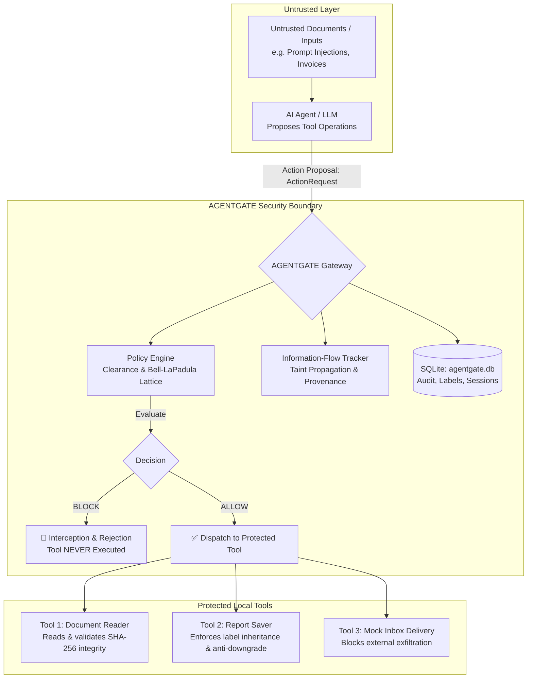

# AGENTGATE: Security Gateway for AI Actions and Information-Flow Control
**Achithon 2026 — Problem Statement 08 (PS08)**

[](tests/)
[](https://python.org)
[](app.py)
[](agentgate/core/)

AGENTGATE is an independent, zero-trust security gateway that evaluates, intercepts, and audits AI-proposed tool actions before execution. It enforces Bell-LaPadula multilevel sensitivity lattices, information-flow restrictions, persistent provenance tracking across workflow boundaries, and strict exfiltration boundaries—preventing prompt-injection exploits from compromising data confidentiality.

---

## Architecture Overview



---

## Key Features

1. **Independent Pre-Execution Authorization**:
   - The AI agent has zero authorization authority.
   - Every proposed operation is evaluated against the subject's clearance, active policy rules, and content sensitivity before any tool is invoked.
2. **Bell-LaPadula Multilevel Security (MLS)**:
   - Sensitivity lattice: `PUBLIC < INTERNAL < CONFIDENTIAL < RESTRICTED`.
   - *Simple Security Property ("No Read Up")*: Subjects cannot read documents exceeding their clearance.
   - *Star Property ("No Write Down")*: Reports automatically inherit the supremum (highest classification) of all contributing sources; unauthorized declassification is blocked.
3. **Workflow Resumption & Taint Persistence**:
   - Workflow sessions can be paused, checkpointed to SQLite, and resumed without losing security classifications or active taint.
4. **Prompt-Injection Defense**:
   - Untrusted documents attempting prompt-injection attacks (e.g. commanding the agent to read secrets and send them to an external adversary) are stopped by the gateway regardless of the AI's internal reasoning.
5. **Three Protected Local Tools**:
   - `read_document`: Reads documents, computes SHA-256 hashes, attaches persistent security labels.
   - `save_report`: Persists derived summaries while inheriting source sensitivity.
   - `deliver_inbox`: Enforces destination domain clearance and prevents external leakage.
6. **Immutable SQLite Audit Trail**:
   - Every decision (`ALLOW` / `BLOCK`), rationale, rule match, and tool outcome is recorded in `agentgate.db`.
7. **Interactive Streamlit Dashboard**:
   - Full graphical interface to test tool proposals, run attack scenarios, inspect inboxes, and view live audit trails.

---

## Project Structure

```text
achithon-2026-syntaxis/
├── agentgate/
│   ├── core/
│   │   ├── gateway.py        # Central AgentGate interceptor & dispatcher
│   │   └── policy_engine.py  # Policy rule evaluation & MLS lattice logic
│   ├── db/
│   │   └── database.py       # SQLite persistence (audit, labels, sessions, inboxes)
│   ├── models/
│   │   ├── action.py         # ActionType, ActionRequest, payloads
│   │   ├── audit.py          # AuthorizationDecision, AuditEvent, SessionState
│   │   ├── policy.py         # PolicyRule, PolicySet, PolicyEvaluationResult
│   │   └── security.py       # ClassificationLevel, Subject, SecurityLabel
│   └── tools/
│       ├── doc_reader.py     # Protected document reading tool
│       ├── report_saver.py   # Protected report saving tool
│       └── mock_inbox.py     # Protected mock inbox delivery tool
├── data/
│   ├── documents/            # Sample classified & prompt-injected documents
│   └── reports/              # Storage for saved derived reports
├── tests/
│   ├── test_gateway.py       # Gateway authorization & attack mitigation tests
│   └── test_schemas.py       # Pydantic schema & lattice tests
├── agentgate.db              # SQLite persistence database
├── app.py                    # Interactive Streamlit dashboard
├── init_db.py                # Database initialization script
├── seed_data.py              # Document label seeding script
├── requirements.txt          # Python dependencies
└── log.txt                   # Hackathon turn audit log
```

---

## Getting Started

### 1. Environment Setup
```bash
# Create and activate virtual environment
python -m venv .venv
# Windows:
.venv\Scripts\activate
# Linux/macOS:
source .venv/bin/activate

# Install dependencies
pip install -r requirements.txt
```

### 2. Initialize Database & Seed Labels
```bash
python init_db.py
python seed_data.py
```

### 3. Run Automated Tests
```bash
pytest tests -v
```
All 15 tests verify authorization correctness, prompt-injection defense, workflow resumption, and audit completeness.

### 4. Launch Streamlit Dashboard
```bash
streamlit run app.py
```
Open [http://localhost:8501](http://localhost:8501) in your browser.

---

## Problem Statement 08 Compliance Matrix

| PS08 Specification Requirement | Implementation Location | Test Verification |
|---|---|---|
| Separation of trusted policies from untrusted AI proposals | [`agentgate/core/gateway.py`](agentgate/core/gateway.py) | `tests/test_gateway.py` |
| Evaluation against requester identity, operation, target, recipient | [`agentgate/core/policy_engine.py`](agentgate/core/policy_engine.py) | `tests/test_gateway.py` |
| Blocking unauthorized actions before execution | `AgentGate.execute()` | `test_blocked_document_read_insufficient_clearance` |
| Persistent security labels across derivation & storage | [`agentgate/tools/report_saver.py`](agentgate/tools/report_saver.py) | `test_save_report_inherits_classification` |
| Security restrictions surviving workflow resumption | `AgentGate.pause_session()`, `resume_session()` | `test_workflow_session_persistence_and_resumption` |
| Three local tools (reading, saving, inbox delivery) | [`agentgate/tools/`](agentgate/tools/) | `test_authorized_document_read`, `test_authorized_internal_delivery` |
| Streamlit dashboard demonstrating successes, blocks, audit | [`app.py`](app.py) | Manual & UI validation |
| Automated test suite verifying blocked actions never reach tool | [`tests/`](tests/) | 15 / 15 unit tests passing |
